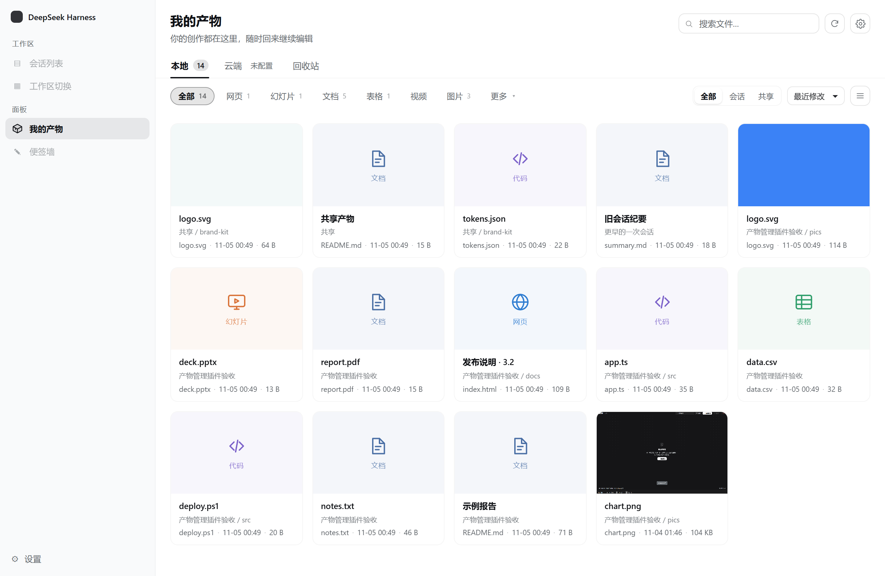
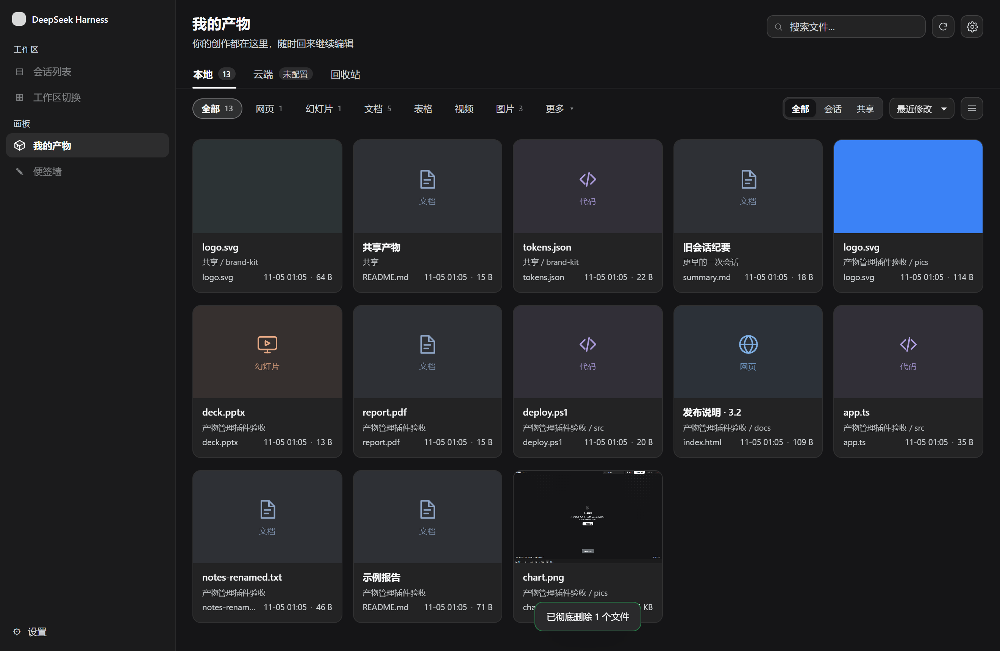
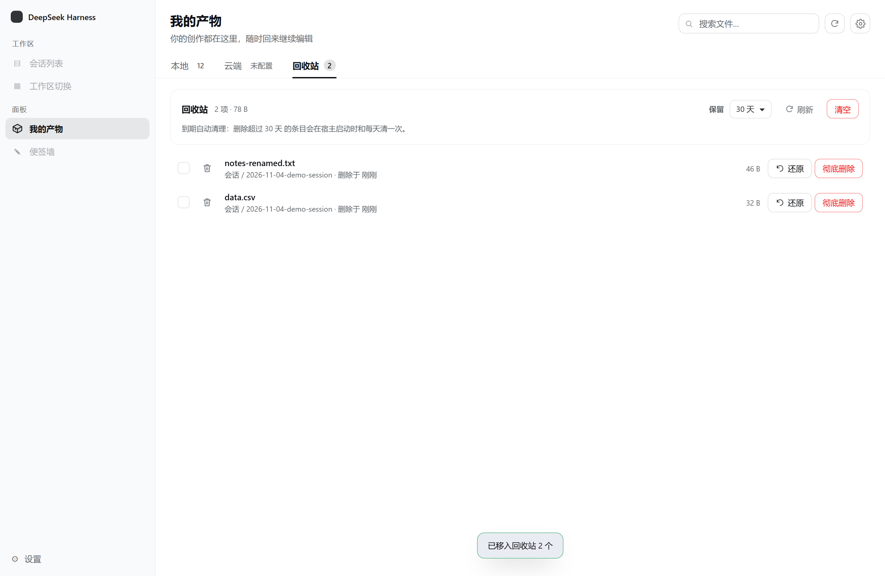
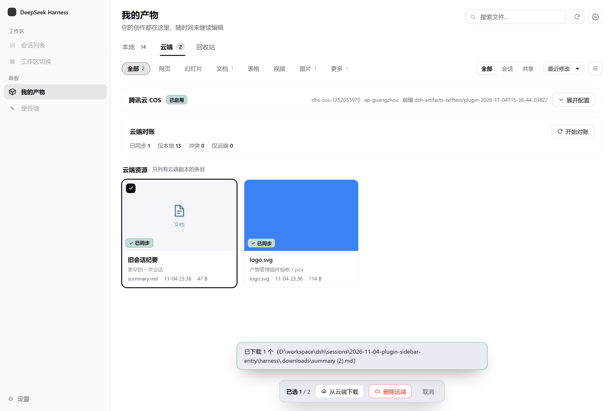
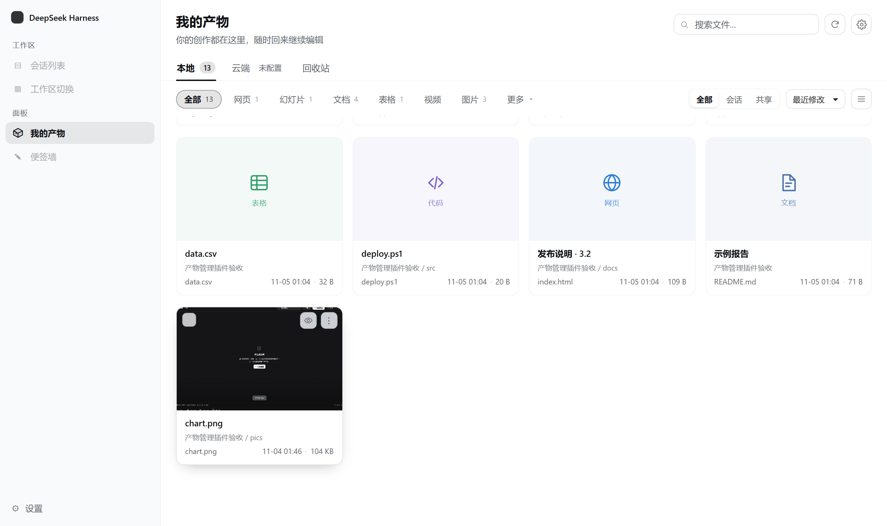
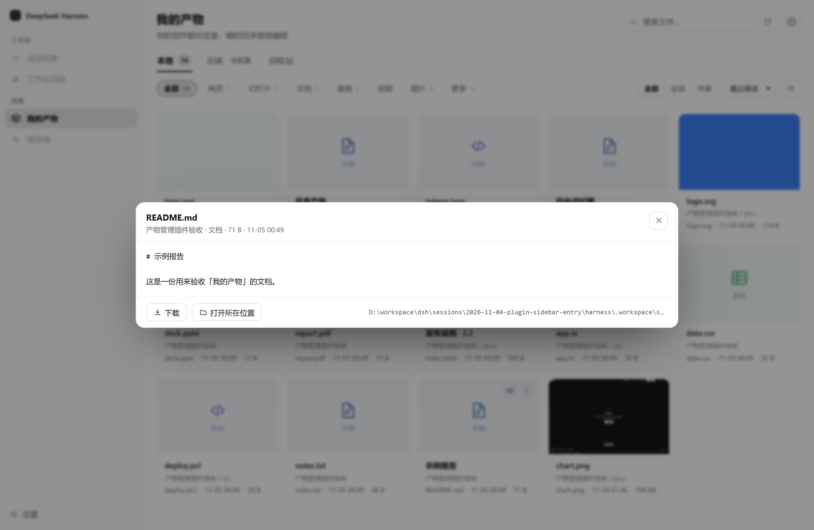
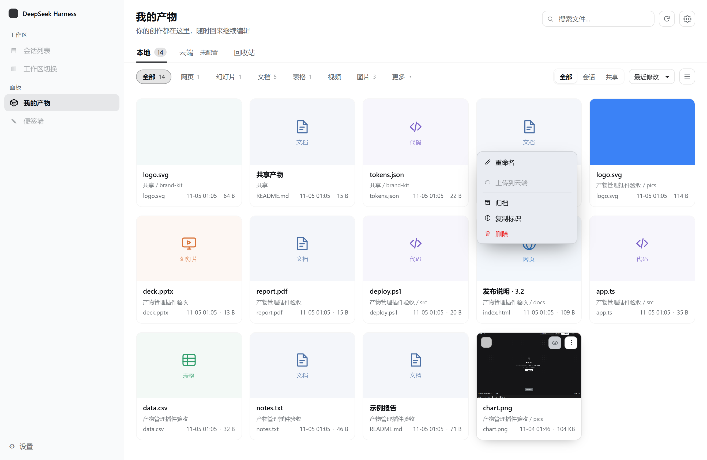
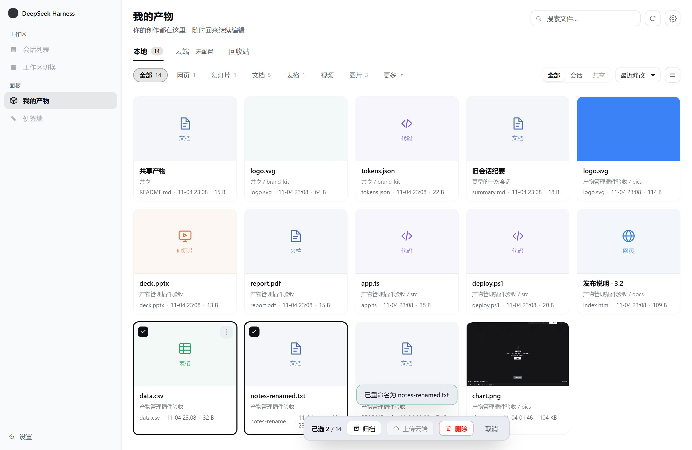

# dsh-plugin-artifacts · 我的产物

DSH 的**侧栏一级入口 + 独立页面**，把工作区里的产物集中管起来：会话里生成的文件、`artifacts/` 里的共享素材，一个页面看完 —— 网格/列表、按类型与来源筛、预览、重命名、移动、回收站、zip 归档，以及**可选的**腾讯云 COS 手动上传。

设计基线：[`sessions/2026-11-01-persona-mgmt/plugin-design-artifact-manager.md`](../sessions/2026-11-01-persona-mgmt/plugin-design-artifact-manager.md)（v1.2）。



| 深色 | 回收站 | 云端（已同步） | 卡片悬停 | 预览（含本地路径） | 卡片菜单 | 批量选择 |
|---|---|---|---|---|---|---|
|  |  |  |  |  |  |  |

---

## 1. 它是什么、不是什么

**做**

- 独立页面「我的产物」，侧栏一级入口（`sidebar.panellist` → `main` keyed 面板，点图标即进）。
- 本地：浏览、搜索、类型/来源筛选、排序、网格/列表、预览、重命名、移动、下载、另存为、删除到回收站、还原、彻底删除、打包归档。
- 单工作区：只看当前宿主的默认工作目录（`<workspace>/sessions` 与 `<workspace>/artifacts`）。
- 云端：只有用户填好 COS 配置并手动开启后才可用；**上传永远手动点**，没有定时器、没有后台同步；下载会先让你选落地目录。

**不做**

- 不做项目树 / 分组 / 工作区切换（那是 DSH 既有导航）。
- 不做自动上传、不做版本控制、不做多人协作。
- 不做 office / 视频缩略图 —— 只有图片有缩略图，其余显示类型图标。

---

## 2. 安装

插件是本地包，profile 里用 `link:` 依赖 + `bundles` 末尾挂一行即可（和 `dsh-plugin-sticky-wall` 同样的装法）：

```powershell
# 1) 在 profile 目录加依赖（D:\Users\<you>\.dsh\profiles\desktop\package.json）
#    "dsh-plugin-artifacts": "link:D:/workspace/dsh/dsh-plugin-artifacts"
#    并把 "dsh-plugin-artifacts" 追加到 dsh.profile.bundles 末尾
cd $env:USERPROFILE\.dsh\profiles\desktop
pnpm install

# 2) 重启 DSH Desktop（host 半侧要重新组合配置树）
```

- **只改 `client.js` 不用重启**：`dsh-client-hmr` 每 500ms stat 一次 client bundle，改动会热替换。
- **改 `index.js` / `lib/*` 必须重启宿主**（host 半侧是进程内的）。

### 工作区是怎么确定的

**主工作区**（数据目录、相对路径解析的基准）解析顺序如下（前一条不成立才走下一步）：

| 顺序 | 来源 | 说明 |
|---|---|---|
| 1 | `config.workspaceRoot` | 在 bundle patch 里写死，最可控 |
| 2 | `workingDirectory.defaultDirectory` | 宿主给的默认工作目录 |
| 3 | `$DSH_HOME/storages/workspace.json` | 桌面端**持久化**的工作区登记表（多工作区时优先有 `sessions/` 的那个） |
| 4 | `DSH_WORKSPACE` / `DSH_WORKSPACE_ROOT` | 环境变量 |
| 5 | `process.cwd()` | 最后兜底 |

第 2、5 条在 Electron 下可能是 DSH 自己的 home / profile 目录，所以会先被 `looksLikeHostHome()` 挡掉 —— 否则会出现「索引成功 0 条、列表永远空白」。
`/status` 会回报 `workspace` 与 `workspaceSource`，页面在 `sessions/` 不存在时的空态里也会直接写出解析到的路径。真实排查时先看宿主日志里的：

```
[dsh-plugin-artifacts] 索引就绪：N 条（<工作区>，来源 <source>）
```

### 多工作区（v3）

主工作区之外，可以在 **设置 → 工作区** 里添加任意多个目录（默认就是安装时识别到的工作区）：

| 能力 | 说明 |
|---|---|
| 添加 / 移除 | 用系统目录选择器；主工作区不可移除（可以改路径）。最多 8 个，自动去重、去掉被包含的子目录 |
| 路径即界面 | 卡片上显示相对路径；散放的文件（没有 `sessions/` 结构）同样能扫到，不要求任何目录规范 |
| 独立项目跳过 | 扫描工作区时，含 `package.json` / `pyproject.toml` / `Cargo.toml` / `go.mod` 的子目录会被整段跳过 —— 想管理它就把那个项目目录单独加为工作区 |
| 根层范围（重要） | 主工作区**存在 `sessions/`** 时，只扫 `sessions/` 与 `artifacts/`（和 v2 一致）；`outfits/`、`ark-output/`、`deliverables/` 这类目录属于「项目/素材」，整棵扫进来会让条目从几十条膨胀到几百条。**没有 `sessions/` 的裸工作区**才整棵扫；**显式添加的额外工作区**一律整棵扫 |
| 云端数字只算「看得见的」 | 云端 tab 的数字按「索引里可见的记录」算，另外用 `recordedTotal` 记住总记录数；两者不一致时面板上会显示一条提示（常见于截图等被扫成「过程」的文件），不会让人以为数据丢了 |
| id 命名空间 | 主工作区沿用旧 id（`会话/相对路径`、`artifacts/…`），云端记录、回收站、前端状态都不失效；额外工作区用 `@<标签>/<相对路径>` |

### 数据目录（裸工作区也能用）

所有派生数据都在**主工作区的数据目录**里：

```
<主工作区>/sessions/.settings.json | .index.json | .cloud.json | .archive.json | .artifacts.json
<主工作区>/.trash/                      回收站（一直在根目录）
```

**没有 `sessions/` 的目录**（把文件全堆在工作区）：数据目录自动退到 `<主工作区>/.dsh-artifacts/`，
并且**不会**为了存索引而凭空创建一个 `sessions/`；`.dsh-artifacts` 本身不参与索引。
`bare-workspace-test.mjs` 16 项覆盖这条路径（含 `.trash` 删除/还原）。

### 扫描类型与角色（v3）

三个开关决定**收什么**，角色决定**怎么显示、要不要备份**：

| 开关 | 收录 | 默认 |
|---|---|---|
| 产物 | 通过产物规则的文件（任意位置，不要求 `sessions/`） | ✅ |
| 记忆 | `MEMORY*` / `PERSONA*` / `HANDOFF*`，或路径含 `memory/` | ✅ |
| 会话 | 会话目录里的过程文件（脚本、截图、夹具） | ❌ |

角色四档：**产物**（默认视图、默认备份范围）、**过程**、**记忆**、**素材**。
判定是纯函数（`lib/roles.js`）：记忆命名族 → 过程目录（`screenshots`/`harness`/`tests`…）→ 过程文件名前缀（`probe-*`/`diag-*`/`verify-*`…，**只对代码类扩展名生效**，`live-notes.md` 仍是文档）→ 素材目录（`uploads`/`assets`…）→ 其余为产物。

类型是第二维，12 类：`doc / sheet / slides / image / vector / video / audio / code / config / web / archive / other`
（`.json→config`、`.svg→vector`、`.html→web`，`code` 只收真正的源码扩展名）。

### 搜索语法

搜索框里可以直接写筛选条件，和关键词混用：

```
type:code               只看代码（type:doc,image 逗号多选）
role:scratch            只看过程（会覆盖「默认只看产物」）
session:<会话目录名>     只看某个会话
type:doc 报告            文档 + 文件名含「报告」
```

多个工作区时会多出一个「工作区」下拉（`全部 / 主 / 各扩展根`），与角色、类型、来源是「与」关系。

### 整理模式（人工标注）
规则只能给初值，最终判断归用户：

- 顶部「整理」按钮 → 按「会话 · 目录」分组列出全部文件；
- 每行三个按钮（产物 / 过程 / 记忆）点一下即生效，分组标题上还有「全设产物 / 全设过程 / 恢复自动」；
- 覆盖写在 `.artifacts.json`（与 `.settings.json` 同目录），只存人工覆盖，规则升级不会冲掉你的判断；
- 人工标过的条目**即使不在当前扫描范围里也会保留**，否则一标成「过程」就从整理界面消失、没法撤销；
- `roleSource: manual | auto` 会回传给界面，标过的行有「人工」角标。

### 备份与自动同步

| 设置 | 含义 | 默认 |
|---|---|---|
| 备份范围 | `仅产物` / `产物 + 记忆` | 仅产物 |
| 自动同步 | 定时把「已传过、但本地改过」的文件重传 | 关闭 |
| 同步间隔 | 5 / 15 / 30 / 60 分钟 | 15 分钟 |

保守语义（故意的）：

- 只处理**有云端记录**且 `stateOf === 'conflict'`（size 或 mtime 变了）的条目；**从不上传没传过的新文件**；
- 过程 / 素材永不上传，即使手动勾选也会被备份范围过滤；
- 单飞、每轮最多 20 个、云端关掉立即停表；`POST /cloud/autosync { runNow: true }` 可手动跑一轮；
- 状态里回报 `last: { at, uploaded, failed, skipped, errors }`，设置面板显示「上次同步 / 待同步 N 个」。

---

## 3. 目录结构

```
dsh-plugin-artifacts/
├── package.json          # dsh.bundle.patch + dsh.client.platform=web
├── cordis.patch.yml      # insert: {id: artifacts, name: dsh-plugin-artifacts}
├── index.js              # host：HTTP 路由 + 文件操作 + 启动任务
├── client.js             # client：手写 __ModuleLoader__ bundle（只 require('react')）
├── lib/
│   ├── util.js           # 类型分类、路径安全、标题推导、敏感文件
│   ├── indexer.js        # 索引 v2：白名单扫描 / 增量 / 查询
│   ├── trash.js          # 回收站：manifest、还原、彻底删除、保留期清理
│   ├── archive.js        # 归档：zip 落 archive/<year>/ + 归档记录
│   ├── zip.js            # 最小 ZIP 写入器（node:zlib，零依赖）
│   ├── settings.js       # .settings.json 读写
│   ├── cloud.js          # COS 映射与状态（.cloud.json + credentials）
│   ├── cos.js            # 零依赖 COS V5 客户端（签名 / PUT / GET / HEAD / LIST）
│   └── cos.selftest.mjs  # 本地 mock 服务器自测（24 项，不联网）
└── docs/                 # 截图
```

**零第三方依赖**：宿主在 profile 里解析第三方 ESM 的钩子不保证可用，所以 `sharp` / `archiver` / `cos-nodejs-sdk-v5` 全都没引 —— zip 用 `node:zlib` 自己写，COS 用 `node:https` + V5 签名自己签，图片缩略图直接交给浏览器缩放原图（`/raw`）。

---

## 4. HTTP API

前缀 `/api/dsh-artifacts`，POST JSON，统一 `{ ok, data }` / `{ ok:false, error:{ code, message } }`。

| 端点 | 说明 |
|---|---|
| `POST /status` | 条目数、总大小、回收站、归档、云端、设置 |
| `POST /index/refresh` | `{full?}` 增量或全量重扫 |
| `POST /items` | `{scope?,kinds?,q?,session?,sort?,order?,cloudOnly?,offset?,limit?}` → `{items,total,hasMore,facets}`；`cloudOnly` 只返回有云端副本的条目 |
| `POST /item/read` | `{id,maxBytes?}` → 文本前 256 KB；二进制返回 `binary:true` + 预览 URL |
| `GET /raw?id=` / `GET /download?id=` | 内联 / 附件流式下载（≤2 GB） |
| `POST /item/rename` `/item/move` | `{id,to}`：`to` 不带斜杠 = 同目录改名，带斜杠 = 移进本会话目录 |
| `POST /delete-token` | `{ids}` → 60 秒一次性删除令牌 |
| `POST /item/delete` | `{ids,token}` 进 `.trash/`（单次 ≤200） |
| `POST /trash/list` `/trash/size` | 回收站列表与占用 |
| `POST /item/restore` `/item/purge` | 还原 / 彻底删除（`{all:true}` 清空） |
| `POST /archive` | `{ids}` 或 `{session}` → `archive/<year>/<name>-<ts>.zip` |
| `POST /reveal` | 系统文件管理器定位 |
| `GET/POST /settings` | `{trashRetention:"7"\|"30"\|"forever", showOthers, sensitiveExcludes}` |
| `POST /cloud/config` `/cloud/test` `/cloud/upload` `/cloud/reconcile` `/cloud/delete-remote` | 云端；未配置一律 `E_CLOUD_DISABLED` |
| `POST /cloud/download` | `{ids,targetDir?}`：落地优先级 = 本次 `targetDir` → 配置里的 `downloadDir` → 原文件旁边加 `.remote.<ts>`；同名一律加 `(2)` 不覆盖 |

---

## 5. 关键设计决定

| 决定 | 为什么 |
|---|---|
| **白名单索引**，默认只收已知类型 | 实测：某个会话目录 348 个文件里 242 个是无扩展名的运行时垃圾。全量索引会让「我的产物」变成文件浏览器。 |
| 缩略图只做图片，且不预生成 | 没有 `sharp` 就不该假装有。图片直接用 `/raw` 交给浏览器缩放，0 磁盘占用、0 转换延迟；其它类型老老实实显示类型图标。 |
| 删除必须带 60 秒令牌 | 二次确认 + 令牌双保险，配合回收站，误删可以还原。 |
| 归档**不隐藏**、**不自动清原目录** | 归档只是「打了一个 zip + 打一个时间点标记」；清不清原目录由用户在卡片菜单里决定，清了也是进回收站。 |
| `archived` 按时间点判断 | `item.mtime <= record.at` 才算已归档 —— 目录里又有新写入时角标自动消失，不需要手工撤销。 |
| 云端 key 首次上传时固化 | `dsh/v2/<会话目录名>/<相对路径>`；共享区 `dsh/v2/_shared/<name>/<rel>`。首次上传写进 `.cloud.json`，之后改目录名也不重算。旧格式 `v1/sessions/<8hex>-<目录>/<rel>` 多两段、还把目录名与 id 各写一遍，已废弃（老记录仍按记录里的 key 读写）。 |
| 冲突判定看「大小或 mtime」 | 上传时记下 size 与 mtime；任一变化即标 `conflict`（同尺寸的内容修改也能抓到），不必每次列目录都算 sha256；重新上传即恢复 `synced`。 |
| 云端状态不哈希 | 列表只看「本地记录 + 大小」，算 sha256 只在真正上传/对账时做，否则每次列目录都要读全盘。 |
| 索引可随时删 | `.index.json` 是派生数据；删掉只会让下次扫描慢一点，用户文件零改动。 |
| 名称排序用自然序 | `Intl.Collator(zh-CN, {numeric:true})`：`2-sample.md` 排在 `10-sample.md` 前面，中文按拼音。 |
| 排序必须有次级键 | 一次批量产出的文件 mtime 常常同秒，只按时间排会「随机跳」；同 mtime 时再按自然名、再按 id 定序。 |
| 云端 tab 只列云端副本 | `/items` 的 `cloudOnly` 过滤掉 `local-only`：本地文件混在里面会让人误以为云端也有东西。 |
| 云端配置可折叠 | 已启用时默认收起成一行摘要（桶 / 区域 / 前缀 + 展开配置），把版面留给资源列表；未配置时自动展开。 |
| tab 上的数字是总量 | 本地 = `/status.items`，云端 = 已上传数，回收站 = 条数；不随当前类型/搜索筛选漂移。 |

### 卡片与菜单的版面约定

| 决定 | 为什么 |
|---|---|
| 卡片三行：标题（最多两行）/ 路径 / 元信息 | 路径（`会话名 / 子目录`）之前只在列表视图里有；标题放开到两行，长标题不再一行就截断。 |
| 元信息永远单行：文件名可省略，日期与大小不让位 | 只有 `.ap-metaText` 可伸缩（`flex:1 1 auto; min-width:0`），其余 `flex:none` + `white-space:nowrap`；`margin-top:auto` 让日期/大小在卡片底部对齐成一列。 |
| 卡片入场只做透明度 | 卡片一旦有 `transform`（哪怕 animation 结束后的 identity matrix）就会成为 `position:fixed` 菜单的 containing block，菜单坐标会按卡片算、整体飞出租口。 |
| 右上角两个图标：`预览` + `更多` | 预览是最高频动作，不该藏在菜单里；两个按钮同组淡入，不会一个先出现一个后出现。 |
| 菜单只放「改动」类操作 | 预览 / 下载 / 打开位置都在预览弹层里，菜单再放一遍就是重复；菜单只剩重命名、云端、归档、复制标识、删除。 |
| 缩略图点击也能预览 | 图片/图标本身是最大的点击目标，`cursor:zoom-in`、回车/空格可达。 |
| 预览弹层同时给出两条路径 | 右下角是**本地绝对路径**（可点复制）；已上传的条目在标题下额外一行**云端 key**（虚线框、可点复制）。云端的「文件在哪」和本地路径是两回事，不该只给一个。 |
| 角标（已归档 / 已同步 / 冲突）在缩略图**左下角** | 左上角留给选择框，右上角留给工具按钮，三者不再互相压。 |
| 「仅本地」不出角标 | 云端一旦启用，每张卡都挂一个灰角标只是噪音；需要时进卡片菜单上传。 |
| `⋯` 菜单用 `position:fixed` + 按按钮 rect 算坐标 | 卡片在滚动容器里，绝对定位的菜单会被容器裁掉（越靠底部越明显）；fixed 之后不受裁剪，靠底时自动向上弹并限高。 |
| 菜单支持 Esc / 点外部关闭 | 键盘可达性，也避免误点。 |
| 云端支持默认下载目录 | 配置里可选一个默认目录（存 `.cloud.json` 的 `downloadDir`）：设了就直接落盘不再弹选择器，没设就每次问。 |
| 批量操作栏出现时 toast 抬高 | 两者都在底部居中，之前会叠在一起。 |
| 目录选择器优先用 `globalThis.__DSH_DIRECTORY_PICKER__` | 内置 UI 也是这么取的（`desktop.pick()`）；直接调 `uiWorkspace.pickDirectory()` 在桌面端可能抛 `directory picker failed: …`。取不到就降级成 info 提示 + 默认位置，配置里的路径输入框也能手填。 |
| 剪贴板必须接住 Promise | `navigator.clipboard.writeText` 返回 Promise，拒绝时若不 catch 就是未捕获异常（控制台报错、用户毫无提示）。现在成功/失败都有 toast。 |
| `spawn` 的失败是异步事件 | 打开文件管理器不挂 `error` 监听的话，spawn 失败会变成未捕获异常、把宿主带崩；现在用 Promise 等 `spawn`/`error`，失败返回 `E_INTERNAL`。 |

### 动效与弹层

| 位置 | 动效 |
|---|---|
| 卡片 | 入场 200ms 纯透明度淡入（**不用 transform**，见上表）；hover 只改边框与阴影 |
| 工具按钮 | 悬停换底色，按下 `scale(.94)` |
| 缩略图 | hover 图片 `scale(1.03)` + 底部渐变遮罩淡入，`cursor:zoom-in` |
| `⋯` 菜单 | 140ms 弹出（`translateY(-4px)` + `scale(.97)` → 原位），`transform-origin: top right` |
| 模态 | 遮罩 150ms 淡入 + 卡片 180ms 上浮；图片预览额外淡入 220ms |
| 提示 | toast 从底部滑入；有批量操作栏时自动抬高 86px |
| 滚动条 | 侧栏主体 / 模态体 / 菜单统一细滚动条，颜色取 `--dsw-alias-border-l2` |
| 无障碍 | `prefers-reduced-motion: reduce` 时全部动画与过渡关闭；菜单与弹窗均支持 Esc、点外部关闭；确认类对话框默认焦点落在「取消」上，避免回车误删 |

### 主题一致性

- 界面色全部走宿主令牌（`--dsw-alias-bg-base / bg-layer-1 / bg-layer-2 / bg-overlay / border-l1 / border-l2 / brand-primary / label-primary / label-secondary / state-error|warn|success-primary`），切主题时自动跟随；角标的「已归档 / 已同步 / 冲突」也用 `state-warn / state-success / state-error` 而不是写死的十六进制。
- 只有「压在内容上的颜色」是固定的，并且单独给了深色覆盖：缩略图悬停遮罩、模态遮罩、深色下的卡片阴影；缩略图图标在深色下用 `color-mix` 提亮，避免深底深字。
- 自定义类型色（`--ap-hue`）只用于图标和 6% 底色，不参与文字对比度。

### 与设计文档的差异（都是实现层的收敛，不影响交互）

1. **页面用 `main` keyed 面板，不是 `shell.overlay`**：`sidebar.panellist` 的 id 直接作为 `main` 的 key，点侧栏图标就是「切到这个页面」，有选中态、能切回会话；overlay 会压在所有列上面，反而更像弹窗。
2. **设置做进页面**（头部齿轮、回收站页的保留期下拉），没有另注册 `settings.plugins.tab` —— 少一个入口，少一次跳转。
3. **共享产物的 `id` 带 `artifacts/` 前缀**（会话产物仍是 `<session>/<path>`）：这样单靠 id 就能无歧义定位文件，不用到处传 `scope`。
4. **COS 大文件用单次 PUT**（不切片）：COS 单次 PUT 支持到 5 GB，切片只是断点续传的收益；接口里预留了 20 MB 的提示阈值。
5. **`.cloud.json` 额外记 `paths`**（id → 上传记录），`items` 仍按 `sha256:` 归并；前者给列表状态用，后者给去重与对账用。
6. **归档部分文件时记录 `ids`**：只给真正打包的那几个打角标，同会话其它文件不受影响。

---

## 6. 安全

| 风险 | 措施 |
|---|---|
| 路径穿越 | `normalizeRel` 拒绝绝对路径/盘符/`..`；`resolveInside` 做前缀校验（Windows 大小写不敏感） |
| 误删 | 令牌 + 二次确认 + 回收站（7/30/永久） |
| 敏感文件 | `.env*` `*.key` `*.pem` `credentials*` 不入列表、不可上传、不可改名为敏感名 |
| 大文件 | 预览 ≤256 KB、传输 ≤2 GB、上传前检查大小 |
| 密钥 | 只写 `ctx.credentials`（`DSH_ARTIFACTS_COS_SECRET_ID` / `_SECRET_KEY`），`.cloud.json` 里只有引用名，回显只给尾号 |
| 并发 | 上传并发 3；索引扫描 15 秒节流、并发共享同一 promise |

---

## 7. 卸载

```powershell
# profile/package.json 去掉依赖与 bundles 里的那一行，然后
cd $env:USERPROFILE\.dsh\profiles\desktop
pnpm install
```

插件只会在工作区留这些**可再生**文件：`sessions/.index.json`、`sessions/.settings.json`、`sessions/.archive.json`、`sessions/.cloud.json`、`.trash/`、`archive/`。用户文件零改动。

---

## 8. 验证

重启宿主后可以先跑一条自检，确认 v3 真的加载了：

```bash
node sessions/<会话目录>/harness/post-restart-check.mjs            # 默认 http://127.0.0.1:1234
```

它会检查 `version / roots / scan / byRole / roles / autoSync`、以及「默认只返回产物」；退出码 0 表示宿主已在 v3 上。


自动化都在 `sessions/2026-11-04-plugin-sidebar-entry/harness/`：

```powershell
node server.mjs             # 真 host 半侧 + 真 client bundle + 真 HTTP（假 cordis / 假 slots / 假凭据服务）
node api-test.mjs           # 86 项接口断言
node drive.mjs              # 31 项 UI 断言 + 截图（playwright）
node workspace-test.mjs     # 6 项工作区解析（服务未就绪 / 返回 profile / 正常 / 显式配置）
node live-refresh.mjs       # 4 项「页面开着时外部写文件自动出现」
node lib/cos.selftest.mjs   # 24 项 COS 客户端自测（本地 mock，不联网）
```

覆盖：白名单与敏感文件、类型/来源/搜索/分页/自然序排序、路径穿越、预览、重命名与移动的冲突与越界、删除→还原→彻底删除、zip 归档与「归档后新增文件自动撤销角标」、云端 `E_CLOUD_DISABLED`、云端 tab 只列云端副本、配置折叠、设置回退、深浅色、空态、控制台零错误。

### 真机 COS 验证（已完成）

对真实桶跑过三层，全部通过：

| 层 | 脚本 | 项数 | 覆盖 |
|---|---|---|---|
| 模块 | `cos-real-smoke.mjs` | 13 | `test()`、put/head/get/list/remove、中文+空格 key、`x-cos-meta-sha256`、404 语义 |
| 插件 API | `cloud-api-test.mjs` | 26 | 配置保存与密钥脱敏、连接测试、上传、cloudOnly 过滤、对账、重复上传幂等、冲突检测、下载 `.remote.<ts>`、远端删除开关 |
| 页面 | `cloud-ui.mjs` | 14 | 已启用时配置收起、展开回填、页面内上传、已同步角标、对账、清理 |
| 真实宿主 | `live-cloud.mjs` | 16 | loopback 直连真实宿主配置 + 全链路 + 开关复位 |

约定：测试对象一律写在 `dsh-artifacts-selftest/` 前缀下并在结束时清空；`live-cloud.mjs` 用 `dsh/` 前缀上传一个真实产物后立即删除远端副本，桶最终为空。
